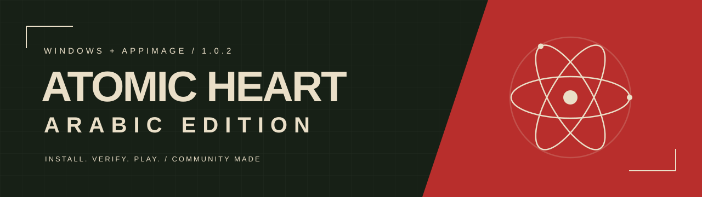

<div align="center">



# AtomicHeart-AR · تعريب أتوميك هارت

**عِش عالم Atomic Heart بالعربية.**

مشروع تعريب مجتمعي للحاسب، مع قاعدة ترجمة مفتوحة وأدوات بناء وتحقق موثّقة.

[](https://store.steampowered.com/app/668580/)
[](docs/releases/v1.0.0.md)
[](LICENSE)

[الإصدارات والتنزيل](https://github.com/TDVVG-3/AtomicHeart-AR/releases) · [طريقة التثبيت](#التثبيت) · [المشاكل المعروفة](KNOWN_ISSUES.md) · [المساهمة](CONTRIBUTING.md)

</div>

---

## عن المشروع

يعرّب المشروع نصوص اللعبة عبر حزمة تستبدل **خانة اللغة الكورية**، مع خط داعم للعربية
وبقاء الصوت الإنجليزي. يقرأ مسار البناء موارد اللعبة، ويحافظ على النص الإنجليزي بجانب
الترجمة، ثم يتحقق من البيانات قبل بناء حزم التعريب. التثبيت محصور في `Paks\~mods`؛
لا يغيّر ملفات اللعبة التنفيذية أو DLL أو حزم اللعبة الأصلية.

| المعلومة | التفاصيل |
| --- | --- |
| المنصة الموثّقة | Windows · Steam، رقم التطبيق `668580` |
| نسخة اللعبة في تقارير التحقق | Steam build `24534183` |
| مجموعة التعريب الافتراضية | `p12 + font v3 + tips_x150` |
| لغة النص المختارة داخل اللعبة | **Korean / الكورية** |
| الصوت | الإنجليزي يبقى كما هو |
| ترخيص كود المشروع وتوثيقه | [MIT](LICENSE) |

## ما الذي يتضمنه التعريب؟

- قاعدة رئيسية تضم **27,618 صفًا**؛ منها **26,717 صفًا عربيًا** و**458 صفًا** تحتفظ
  بالأسماء الإنجليزية، مع **443 صفًا** غير مترجم ضمن فئة النسخ.
- إبقاء أسماء الأسلحة والعناصر الإنجليزية الأصلية، مع تعريب الأوصاف والتلميحات.
- استبدال **1,140 تسمية متحدث** من `P-3` إلى **«الرائد»**.
- خط v3 يدعم العربية ويحافظ على تغطية المحارف الموروثة من النص المصدر.
- تقارير لفحص الترجمة والخطوط وتوقيت الترجمة النصية والتثبيت والاسترجاع.

الأرقام من [حالة المشروع](STATUS.md) و[تقرير p12](reports/p12_master.md).
نسخة `p12g` تجريبية لمعالجة بعض مشاكل التوقيت، وليست ضمن الحزمة الافتراضية.

## التنزيل

تجد الملفات المنشورة في [صفحة الإصدارات الرسمية](https://github.com/TDVVG-3/AtomicHeart-AR/releases).
توضح [ملاحظات 1.0.0](docs/releases/v1.0.0.md) محتويات الحزمة المطلوبة وحالة تجهيزها.

> **حالة حزمة 1.0.0: قيد التجهيز.** ملفات `.pak` الجاهزة ليست ضمن المستودع.
> خيار **Source code (zip)** يحمّل مصدر المشروع وقاعدة الترجمة، ولا يثبّت التعريب.
> يلزم إرفاق الحزم الثلاث المعتمدة والتحقق من بصماتها قبل إعلان تنزيل التعريب جاهزًا.

## التثبيت

بعد توفر حزمة التعريب الجاهزة:

1. أغلق اللعبة تمامًا، وفك ضغط حزمة التعريب خارج مجلد اللعبة.
2. احتفظ بنسخة احتياطية من مجلد `~mods` إن كان موجودًا.
3. انسخ **ملفات `.pak` الثلاثة المذكورة أدناه فقط** إلى المجلد التالي، وأنشئ `~mods` عند الحاجة:

   ```text
   ...\Atomic Heart\AtomicHeart\Content\Paks\~mods
   ```

4. شغّل اللعبة، واختر **Korean / الكورية** من إعداد **Text Language**.

اللغة العربية تستخدم خانة الكورية؛ لن يظهر خيار مستقل باسم العربية في قائمة اللغات.
تفاصيل ذلك في [توثيق اختيار اللغة](docs/LANGUAGE_SELECTION.md).

### ملفات الحزمة الافتراضية

| الوظيفة | اسم الملف | الحجم بالبايت |
| --- | --- | ---: |
| النصوص · p12 | `zzz_atomicheart-ar_carrier_koKR_p12_P.pak` | 4,470,295 |
| الخط · v3 | `zzz_atomicheart-ar_font_p3_unhinted_P.pak` | 1,455,228 |
| التلميحات · x150 | `zzz_atomicheart-ar_tips_x150_P.pak` | 75,853 |

قارن بصمات الملفات مع [SHA256SUMS](docs/releases/v1.0.0-SHA256SUMS.txt) قبل التثبيت.
للتحقق محليًا في PowerShell:

```powershell
Get-FileHash -Algorithm SHA256 .\*.pak
```

الحجوم والبصمات مرجعية من [تقرير التثبيت](reports/install_verification.md)؛
تحتاج ملفات التنزيل الفعلية إلى التحقق منها قبل النشر.

### إزالة التعريب

أغلق اللعبة، واحذف ملفات الحزمة الثلاثة أعلاه فقط من `~mods`، ثم استعد نسختك الاحتياطية
واختر لغة النص التي تريدها. إذا ثبّتَّ التعريب عبر أدوات المشروع، فاستخدم قائمة الملفات في
`atomic-heart-ar-install-manifest.json`؛ لا تحذف مودات أخرى موجودة في المجلد.

## التحقق والقيود المعروفة

هذه نتائج **التقارير المحفوظة في المستودع**، وليست اختبارات أُعيد تشغيلها عند تعديل التوثيق:

| الفحص | النتيجة المسجّلة | الدليل |
| --- | --- | --- |
| الترجمة، ستة متغيرات من عائلة p12 | PASS · صفر أخطاء صلبة | [ملخص الفحوص](reports/p12_gate_all.md) |
| تغطية الصفوف | 27,618 / 27,618 محسوبة | [الحالة](STATUS.md) |
| الخط | PASS · صفر محارف مفقودة مستحدثة بسبب العربية | [الحالة](STATUS.md) |
| إعادة استخراج حزمة النصوص | 35 / 35، وتطابق البايتات بعد فك الحزمة | [التسليم التقني](HANDOFF.md) |
| التثبيت والاسترجاع | PASS · صفر تغييرات خارج `~mods` | [تقرير التثبيت](reports/install_verification.md) |

قد تستمر بعض مشاكل تراكب الترجمة النصية أو قصّها عند ظهور أربعة أسطر. بعض مشكلات التوقيت
مرتبطة ببيانات اللعبة الأصلية ولا يصلحها تعديل النصوص وحده. توجد **343 حالة H3** دون مدة
صوت قابلة للاستخدام. راجع [المشاكل المعروفة](KNOWN_ISSUES.md) و[دليل اختبار الترجمة النصية](reports/stack_test_guide.md).

للإبلاغ عن مشكلة، [افتح Issue](https://github.com/TDVVG-3/AtomicHeart-AR/issues/new)
وأرفق نسخة اللعبة، وأسماء حزم التعريب، وصورة أو خطوات إعادة المشكلة.

## للمطورين والمساهمين

ابدأ من [دليل المساهمة](CONTRIBUTING.md)، و[سلسلة الأدوات](docs/TOOLCHAIN.md)،
و[التسليم التقني](HANDOFF.md). تمر تعديلات الترجمة عبر قواعد TM/fixup مع الحفاظ على
النص الإنجليزي؛ لا تُعدَّل الصفوف المولّدة يدويًا لتجاوز فشل التحقق.

<details>
<summary><strong>Build from source · متطلبات وأوامر التحقق</strong></summary>

The build pipeline targets Windows, PowerShell 5.1, .NET 8, and Python 3. Obtain
third-party tools from the upstream releases listed in [tools.lock.json](tools/tools.lock.json).
Tool binaries, original game resources, generated font payloads, and local build outputs
are not included in a source download.

Several scripts use `C:\AtomicHeart-AR` as their working root. The commands below
assume that location and require the generated p12 master and font staging inputs
to exist already; they are not a complete fresh-clone build.

```powershell
cd C:\AtomicHeart-AR
powershell -NoProfile -ExecutionPolicy Bypass -File scripts\setup_tools.ps1
powershell -NoProfile -ExecutionPolicy Bypass -File scripts\validate_translation.ps1 -Master build\variants\atomic-heart-ar_p12.tsv
powershell -NoProfile -ExecutionPolicy Bypass -File scripts\glyph_gate.ps1 -PayloadRoot build\staging\font_v3\modpakfont -ReportPath reports\glyph_gate_local.md
powershell -NoProfile -ExecutionPolicy Bypass -File scripts\build_carrier_locres_pak.ps1 -Master build\variants\atomic-heart-ar_p12.tsv -VariantLabel p12
```

See [the toolchain](docs/TOOLCHAIN.md) and [the handoff](HANDOFF.md) for the build
context, [p12_gate_all.ps1](scripts/p12_gate_all.ps1) for the gate chain, and
[switch_variant.ps1](scripts/switch_variant.ps1) for snapshot, backup, verification,
and automatic rollback when switching an installed set.

</details>

### خريطة المستودع

| المسار | المحتوى |
| --- | --- |
| [localization/master/](localization/master/) | قاعدة النص الإنجليزي والترجمة العربية |
| [localization/working/](localization/working/) | قواعد TM والإصلاحات وقوائم الأسماء الأصلية |
| [scripts/](scripts/) | الاستخراج والتحقق والبناء والتثبيت والاسترجاع |
| [reports/](reports/) | أدلة الفحوص والتدقيق والاختبارات |
| [docs/](docs/) | توثيق الصيغ والأدوات والخطوط واختيار اللغة |
| [glossary/](glossary/) | المصطلحات والصيغ المعتمدة |
| [config/](config/) | مسارات اللعبة وإعدادات البناء |
| `build/` و`dist/` | مخرجات محلية؛ ملفات الحزم ليست ضمن Git |

## الحقوق والشكر

مشروع تعريب غير رسمي، بإشراف [TDVVG-3](https://github.com/TDVVG-3) ومساهمات المجتمع.
تعود Atomic Heart وأصولها وأسماؤها وعلاماتها إلى Mundfish وأصحاب الحقوق المعنيين.
كود المشروع وتوثيقه تحت [MIT](LICENSE)؛ تراخيص المكونات الأخرى في
[THIRD_PARTY_LICENSES.md](THIRD_PARTY_LICENSES.md).
لا تتضمن ملفات المصدر أرشيفات اللعبة الأصلية أو EXE أو DLL أو أدوات غير مرخّصة لإعادة التوزيع.

<div align="center">

[سجل التغييرات](CHANGELOG.md) · [حالة المشروع](STATUS.md) · [التسليم التقني](HANDOFF.md) · [المساهمة](CONTRIBUTING.md)

</div>
