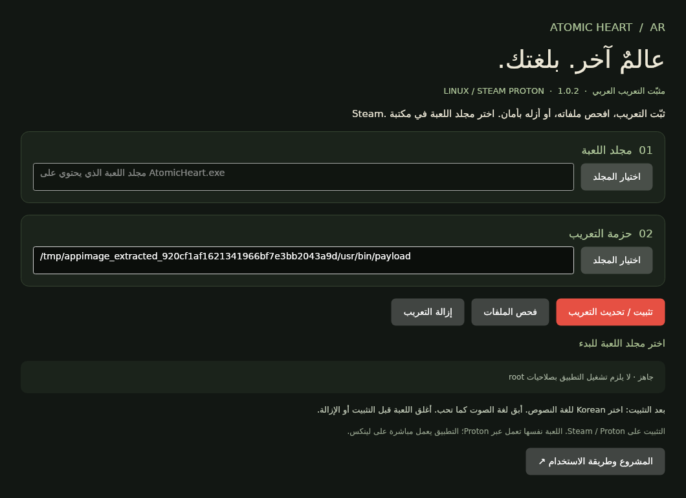

# AtomicHeart-AR 1.0.2

إصدار يجمع تطبيق ويندوز ونسخة Linux AppImage مع تصحيحات التعريب.
نشر Release في المستودع الأصلي ينتظر صلاحية المالك؛ الحزم تُرفق بنتائج
[البناء الآلي](https://github.com/exelight7/AtomicHeart-AR/actions/workflows/release-1.0.2.yml)
إلى حين نشرها في [إصدارات المشروع](https://github.com/TDVVG-3/AtomicHeart-AR/releases).
تنزيل مرفقات Actions يتطلب تسجيل الدخول إلى GitHub.

## نشر الإصدار بواسطة المالك

بعد دمج [الطلب #5](https://github.com/TDVVG-3/AtomicHeart-AR/pull/5)، افتح
**Actions → Build and verify 1.0.2 → Run workflow** في المستودع الأصلي،
واختر الفرع المدموج وفعّل **Publish v1.0.2**. يعيد المسار بناء الحزمتين
واختبارهما، ويتحقق من البصمات، ثم ينشر Release بمرفقات Windows وAppImage
والتعريب وبصماتها. النشر لا يعمل في النسخة المتفرعة ولا في تشغيل طلبات الدمج.
يرفض المسار الكتابة فوق إصدار موجود.

## الملفات

| الملف | المحتوى |
| --- | --- |
| `AtomicHeart-AR-1.0.2-win-x64.zip` | تطبيق ويندوز وبيئة التشغيل والتعريب |
| `AtomicHeart-AR-1.0.2-linux-x86_64.AppImage` | تطبيق لينكس وبيئة التشغيل والتعريب في ملف واحد |
| `AtomicHeart-AR-1.0.2-payload.zip` | ملفات التعريب الثلاثة للتركيب اليدوي |
| `*.sha256` | بصمة كل ملف تنزيل للتحقق من سلامته |

طريقة التشغيل بالتفصيل في [دليل التطبيق](../../app/README.md).
اختر **Korean** للغة النص داخل اللعبة بعد التركيب.

## قبل وبعد، ولماذا

| قبل | بعد | السبب |
| --- | --- | --- |
| تطبيق WPF لويندوز فقط | واجهة Avalonia عربية على لينكس، مع إبقاء واجهة ويندوز | تشغيل أصلي مع Steam / Proton بدون محرك متصفح |
| الحزمة الجديدة بنفس الاسم تُرفض إذا اختلفت بصمتها | ترقية p12 المعروف إلى 1.0.2 مع نسخة استرجاع أثناء العملية | تحديث آمن دون قبول ملفات مجهولة |
| التصحيحات موجودة في قاعدة الترجمة | ثمانية نصوص مصحّحة داخل PAK المرفق أيضًا | وصول التصحيح الفعلي إلى اللاعب |
| خلط الثواني والدقائق وعدم ضبط بعض مجموعات التوقيت | توحيد الحسابات والتحقق من حدود المقاطع والمجموعات المكررة | منع تراكب جديد ينتج عن أداة بناء التوقيت |
| تدقيق الخط قد يفوّت وجه خط أو حرفًا | فحص الوجوه والصفوف والمحارف المطلوبة | كشف الغليفات الناقصة قبل بناء حزمة |
| تعديل HUD موصوف كأنه يغيّر مساحة العرض | توضيح أنه يغيّر الحشو، مع إبقاء قصّ الأسطر ضمن القيود | عدم الادعاء بإصلاح بصري لم يُثبت داخل اللعبة |

تصحيحات النصوص تشمل «الأسلحة البيضاء»، وصيغة خطاب خاريتون، و«نقاط الضعف»،
وزمن انتظار القدرة، وصياغة تمنّي الفريق، ومطابقة الفعل في جملة الروبوتات، وتصحيح «تؤدّي إصابة».
القيم الكاملة قبل وبعد موثّقة في [قائمة التصحيحات](translation-fixes-1.0.2.json).

## الكفاءة وسلامة الملفات

- AppImage ذاتي التشغيل مع نشر ReadyToRun وضغط zstd؛ لا يحتاج تثبيت .NET.
- قراءة بصمات الملفات على دفعات، والنسخ والفحص خارج مسار واجهة المستخدم.
- لا خدمات خلفية أو تحديث دوري أو اتصالات شبكة داخل المثبّت؛ سجل لينكس محدود بخمس رسائل.
- قفل يمنع عمليتي كتابة متزامنتين، ورفض الروابط داخل وجهة التثبيت والملفات غير المعروفة.
- تعارض حزمة p12g أو أي carrier آخر يوقف التثبيت بدل تركيب نسختين متنافستين.
- أدوات البناء محققة بالبصمات؛ نسخ الاعتماديات مقفلة وملفات تراخيصها مرفقة.

## نتائج التحقق

اجتاز [البناء النهائي على GitHub Actions](https://github.com/exelight7/AtomicHeart-AR/actions/runs/40843554060)
الفحوص على commit `f5d8c887cdf036776baba7aafbcb549d744c6358`:

| الفحص | النتيجة |
| --- | --- |
| محرك التثبيت على Windows | 27 اختبارًا ناجحًا، تشمل الحزمة الفعلية |
| محرك التثبيت على Linux | 31 اختبارًا ناجحًا، تشمل روابط Steam وعملية Proton |
| التوقيت والخط | 18 اختبارًا ناجحًا، تشمل القاعدة الكاملة |
| حزمة التعريب | 8 تصحيحات، و35/35 ملفًا متطابقًا بعد إعادة الفك |
| نافذة AppImage | تشغيل وتصوير ناجحان على Ubuntu 22.04 / Xvfb |

حجم AppImage **44,481,016 بايت (42.42 MiB)**، وحزمة ويندوز **70,117,731 بايت (66.87 MiB)**.
استغرق اختبار نافذة لينكس **2.70 ثانية**، ويشمل مهلة تصوير مقصودة مدتها ثانيتان
والتشغيل بوضع الاستخراج. بلغ أقصى استهلاك ذاكرة للعملية **150.52 MiB** أثناء الاختبار.
هذه قياسات لجهاز CI وليست ضمانًا لزمن الإقلاع أو استهلاك الذاكرة أثناء الخمول على كل جهاز.

## التحقق والحدود

البناء الآلي يفحص التثبيت والترقية والإزالة والاسترجاع في مجلدات لعبة وهمية،
ويفك حزمة النصوص ويعيد قراءتها للتحقق من التعديلات الثمانية وملفاتها الـ35.
اختبار نافذة لينكس يعمل على Ubuntu 22.04 باستخدام Xvfb ويلتقط صورة من التطبيق المعبأ.

التوافق المستهدف: Windows x64 وLinux x86_64 مع glibc 2.35+ وX11/XWayland.
لم تُختبر اللعبة نفسها أو جهاز Steam Deck أثناء تجهيز هذا الإصدار.
الحزمة المستقرة مبنية على p12؛ **تغييرات التوقيت التجريبية p12g غير مرفقة**.
مشكلة قصّ أربعة أسطر من HUD وبعض الحالات المرتبطة ببيانات اللعبة ما زالت تحتاج اختبارًا داخل اللعبة.
